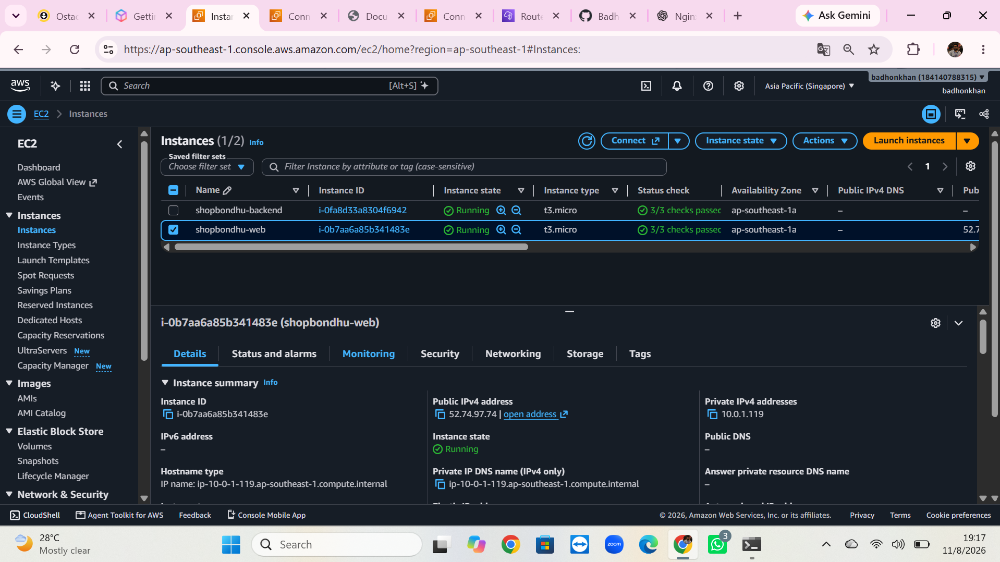

 ShopBondhu AWS Infrastructure Assignment

1. Project Title & Short Description

Project Name: ShopBondhu – AWS Infrastructure Deployment
This project demonstrates the deployment of a ShopBondhu landing page using AWS EC2, VPC, public and private subnets, Internet Gateway, and NAT Gateway.
The frontend is hosted on a public EC2 instance using Nginx, while the backend EC2 instance is deployed inside a private subnet with outbound internet access through the NAT Gateway.

 2. Architecture Diagram

The following diagram represents the AWS infrastructure used in this project.
 

3. Resources Created
Resource	Name	CIDR / ID	Notes
VPC	ShopBondhu	10.0.0.0/16	Custom VPC
Public Subnet	–	10.0.1.0/24	Hosts Web EC2 and NAT Gateway
Private Subnet	–	10.0.2.0/24	Hosts Backend EC2
Internet Gateway	–	[IGW ID]	Internet connectivity
NAT Gateway	–	[NAT ID]	Outbound internet for private subnet
Elastic IP	–	[EIP]	Associated with NAT Gateway
Public EC2	–	[INSTANCE ID]	Nginx web server
Private EC2	–	[INSTANCE ID]	Backend server
Security Groups	–	[SG IDs]	Traffic control
Route Tables	–	[RT IDs]	Public and private routing

4. Step-by-Step Setup

Step 1: Create VPC
Created a custom VPC named ShopBondhu with CIDR block 10.0.0.0/16.

 

Step 2: Create Public and Private Subnets

Created two subnets:
- Public Subnet: 10.0.1.0/24
- Private Subnet: 10.0.2.0/24

Step 3: Create Internet Gateway
Created and attached an Internet Gateway to the ShopBondhu VPC.
 
Step 4: Configure Route Tables
Configured the public route table to route internet traffic through the Internet Gateway.
Configured the private route table to route outbound internet traffic through the NAT Gateway.
Step 5: Create NAT Gateway
Created a NAT Gateway in the public subnet and associated an Elastic IP address with it.
 

Step 6: Configure Security Groups
Configured Security Groups to control access to the public and private EC2 instances.  Public Web Server: Allowed SSH and HTTP traffic. Private Backend Server: Allowed SSH access from the Web Server Security Group.
 

Step 7: Launch EC2 Instances 
Launched two EC2 instances:
1. Public EC2 instance for hosting the frontend.
2. Private EC2 instance for the backend.

 

5. Nginx & Frontend Deployment
Installed Nginx on the public EC2 instance.
Commands used: sudo apt update, sudo apt install nginx -y, sudo systemctl start nginx, sudo systemctl enable nginx, sudo systemctl status nginx

Deployed the ShopBondhu landing page to the Nginx web directory. sudo cp -r frontend/* var/www/html/
Verified the website using the public IPv4 address of the Web EC2 instance.

![Nginx Status] (screenshots/08-nginx-status.png) 

![Website Browser] (screenshots/10-website-browser.png)
 

 6. NAT Gateway Test
Connected to the private backend EC2 instance through the public Web EC2 instance.
Executed: sudo apt update
Also tested internet connectivity: curl -I https://www.google.com
The backend server successfully accessed the internet through the NAT Gateway.

Why is the backend not reachable from the internet?
The backend EC2 instance is deployed in a private subnet. It does not have a public IPv4 address or a direct route to the Internet Gateway. Its outbound internet traffic goes through the NAT Gateway.
The NAT Gateway allows outbound connections but does not allow unsolicited inbound connections from the internet to the backend instance.
Backend NAT Test (screenshots/11-backend-apt-update.png)
 

 7. Troubleshooting Answers

 Problem A
The website doesn't open in the browser, but SSH to the web server works fine. Possible reasons:

1. Nginx is not running : Check: sudo systemctl status nginx & sudo systemctl start nginx
2. Security Group does not allow HTTP traffic
Check the Web Server Security Group inbound rules. Solution: Allow HTTP traffic on port 80 from 0.0.0.0/0.
3. Nginx is not listening on port 80 : Check: sudo ss -tulpn | grep :80
Solution: Check the Nginx configuration and ensure it listens on port 80.
4. Incorrect Public IP address : Check the Public IPv4 address in the AWS EC2 console and use the correct address in the browser.

 Problem B
On the backend server, sudo apt update hangs and times out. Possible reasons:

1. NAT Gateway is in the wrong subnet
The NAT Gateway must be deployed in a public subnet.Check the NAT Gateway subnet in the AWS VPC console.

2. Elastic IP is missing

A public NAT Gateway requires an associated Elastic IP address.Check the NAT Gateway details and verify its Elastic IP association.
3. Private Route Table is incorrectly configured: 
The private route table must contain: Destination  Target 0.0.0.0/0 NAT Gateway ID

4. Public Route Table has no Internet Gateway route
The public route table must contain: Destination  Target 0.0.0.0/0  Internet Gateway ID
5. Security Group blocks outbound traffic
The backend Security Group must allow outbound internet traffic. Check the outbound rules and allow the required traffic, such as HTTPS (443) and HTTP (80), or all outbound traffic for this lab.

Note: Missing inbound access from My IP or the public server's Security Group generally affects SSH connectivity, not outbound apt update
8. Cleanup
After completing the assignment, deleted the NAT Gateway and released its associated Elastic IP address to avoid unnecessary AWS charges.
Cleanup verification:
- NAT Gateway status: [DELETED]
- Elastic IP status: [RELEASED]

9. What I Learned

- Learned how to create and configure a custom VPC with public and private subnets.
- Understood how Internet Gateway and NAT Gateway provide internet connectivity.
- Learned how to deploy a frontend website using Nginx on an AWS EC2 instance.
- Understood how Security Groups and Route Tables control network traffic.
- Learned how to troubleshoot AWS networking issues and clean up resources to avoid unnecessary costs.
